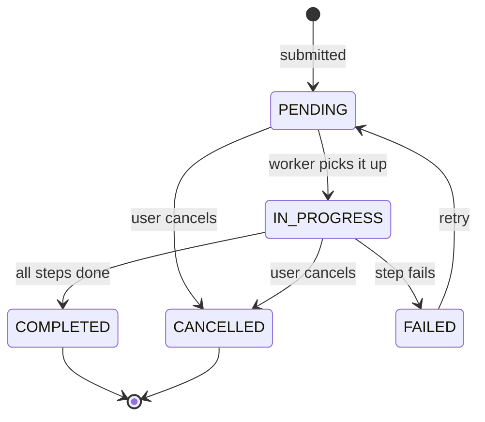

# 1. System analysis

## 1.1 Problem statement

A growing service organisation handles customer service requests by hand. Updates reach people late, and nobody
can see how far along a request is. Operators lose time chasing status, and supervisors find out about problems
after the customer has already complained.

The organisation needs a web application where **operators submit requests**, the system **processes them in the
background**, and **supervisors watch everything move in real time**, without anyone pressing refresh.

### Business objectives

| # | Objective | How we will know it works |
|---|-----------|---------------------------|
| O1 | Give everyone an up-to-the-second view of request progress | A status change is visible on every connected screen in well under a second, with no polling |
| O2 | Handle many requests at the same time | Several requests are processed in parallel and the UI stays responsive meanwhile |
| O3 | Reduce manual follow-up | Operators submit once and are told when it completes or fails |
| O4 | Give supervisors control | Supervisors can see all requests, cancel any of them, and retry failures |
| O5 | Keep a trustworthy record | Every status change is stored with a time and a reason |

### Users

| Role | Description | Can do |
|------|-------------|--------|
| **Operator** | Front-line staff who take requests from customers | Submit requests; see, edit (while pending), cancel and retry **their own** requests |
| **Supervisor** | Team leads who monitor throughput | Everything an operator can, but across **all** requests |
| **Processing engine** | Internal actor (background workers) | Moves requests through the processing steps and records progress |

### Assumptions

1. "Processing" a request is a multi-step workflow that takes seconds to minutes (validate, assign, perform
   service, quality check, close). The real work is simulated with timed steps. A real deployment would replace
   the body of one function (`ProcessingEngine._process`) with calls to the actual fulfilment systems.
2. A small, configurable share of requests fail during the service step (default 8%) so that failure handling
   and retry can be demonstrated.
3. Roles are fixed per user. Users are pre-created (seeded demo accounts); user administration is out of scope.
4. Operators should not see each other's requests. Supervisors see everything.
5. One server instance is enough for the initial rollout. Section 2.8 of the design describes how it would scale out.
6. Users have a modern evergreen browser (WebSocket, ES modules, `<dialog>`).
7. Time is stored in UTC and shown in the viewer's local time zone.
8. SQLite is acceptable as the persistent store for the assessment. The data layer is SQLAlchemy, so
   moving to PostgreSQL is a configuration change (`DATABASE_URL`).

### Scope

**In scope**

- Authentication and role-based access (operator / supervisor)
- Create, view, search/filter, edit (pending only), cancel and retry service requests
- Concurrent background processing with live progress
- Live push updates to all affected users over WebSockets
- Dashboard counters (per status, average run time)
- Status history (audit trail) per request
- REST API with validation and consistent errors, health endpoint
- Automated tests, Docker packaging, CI

**Out of scope** (listed so the boundary is explicit)

- User self-registration, password reset, SSO
- Customer-facing portal, e-mail/SMS notifications
- File attachments
- Multi-tenant separation
- Horizontal scaling infrastructure (designed for, not built)

## 1.2 Functional requirements

Priority: **M** = must, **S** = should.

| ID | Requirement | Pri |
|----|-------------|-----|
| FR-1 | A user can sign in with a username and password and stays signed in for a limited time | M |
| FR-2 | An operator can create a service request with a title, description, category and priority | M |
| FR-3 | The system validates input (lengths, allowed values) and returns field-level messages | M |
| FR-4 | Every request gets a human-readable reference (`SR-00012`) | M |
| FR-5 | New requests are queued automatically and processed by background workers without further action | M |
| FR-6 | Higher-priority requests are picked up before lower-priority ones; equal priority is first-come-first-served | S |
| FR-7 | Several requests are processed at the same time | M |
| FR-8 | Processing shows a current step and a 0-100 % progress value | M |
| FR-9 | Status, progress and step changes are pushed to connected clients immediately (WebSocket) | M |
| FR-10 | A user can list requests with pagination | M |
| FR-11 | A user can search by text (title, description, reference) and filter by status, priority and category, and sort | M |
| FR-12 | A user can open a request to see its details and complete status history | M |
| FR-13 | A user can cancel a request that is pending or in progress; a running request stops at the next step | M |
| FR-14 | A user can edit title, description, category and priority while the request is still pending | S |
| FR-15 | A failed request shows the reason and can be retried (goes back in the queue) | S |
| FR-16 | Operators only see their own requests; supervisors see all | M |
| FR-17 | The dashboard shows live counts per status and the average completion time | S |
| FR-18 | Every status change is recorded with timestamp and message | M |
| FR-19 | If the server restarts, interrupted requests are re-queued automatically | S |
| FR-20 | The client reconnects automatically after a dropped connection and re-syncs what it missed | M |

### Request lifecycle

"Update request status" is deliberately not a free-form operation. Status only changes through these named
transitions (worker progress, cancel, retry), which keeps the data consistent and the audit trail meaningful.

## 1.3 Non-functional requirements

| Area | Requirement | How it is met |
|------|-------------|---------------|
| **Performance** | List/search responds in under 200 ms for typical data; a status change reaches clients in under 1 s | Indexed columns (status, owner+created), pagination capped at 100, push instead of poll |
| **Responsiveness** | Long-running work never blocks the API | Work runs in asyncio worker tasks; DB calls run in threads (`to_thread`); verified by an automated test |
| **Scalability** | Handle more simultaneous requests by configuration; path to multiple instances | Worker count is a setting; stateless tokens; DB-agnostic data layer. Scale-out plan in the design doc |
| **Reliability** | No lost work, no inconsistent state | Persisted queue state; startup recovery; atomic compare-and-set transitions; failures are caught per request so one bad request cannot stop a worker |
| **Concurrency safety** | Cancel and completion at the same instant cannot corrupt a request | Conditional `UPDATE ... WHERE status IN (...)`; the loser of the race is told so |
| **Security** | Only authenticated users reach data; users only see what they own | PBKDF2 password hashes, HMAC-signed expiring tokens, role checks in the service layer, 404 (not 403) for other users' ids, parameterised SQL, all rendered text set via `textContent` (no HTML injection) |
| **Usability** | A new user can submit a request in under a minute | Short form, inline validation, plain-language errors, keyboard-operable list and dialogs |
| **Accessibility** | Usable with keyboard and screen readers | Labelled inputs, `aria-invalid`/`role=alert` errors, focus management for drawer/dialog, visible focus, reduced-motion support, status shown as text not just colour |
| **Responsive design** | Works from phone to desktop | Fluid grid, rows collapse to a stacked layout under 760 px |
| **Maintainability** | Easy to change and test | Layered backend (router, service, repository), configuration in one place, 24 automated tests, small modules |
| **Observability** | Problems can be diagnosed | Structured request logs with timings, worker logs, `/api/health` with queue depth and connection counts |
| **Availability** | Single-instance uptime with fast recovery | Container image with health check, restart-safe state |
| **Portability** | Runs anywhere with Python or Docker | No build step for the frontend, SQLite by default, Dockerfile and compose file |

## 1.4 Risks and trade-offs

| Risk | Mitigation / decision |
|------|----------------------|
| SQLite allows one writer at a time | WAL mode + busy timeout; writes are tiny and short. Switch to PostgreSQL for heavier load |
| In-process queue is lost on restart | Source of truth is the database; on startup, interrupted work is re-queued |
| WebSocket fan-out lives in one process | Fine for one instance; a Redis pub/sub bridge is the documented next step |
| Token in WebSocket URL appears in access logs | Acceptable for this scope; production would use a short-lived one-time ticket |
