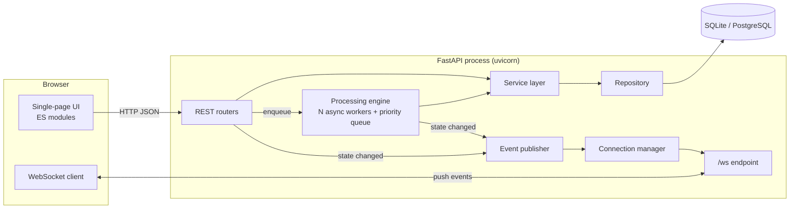
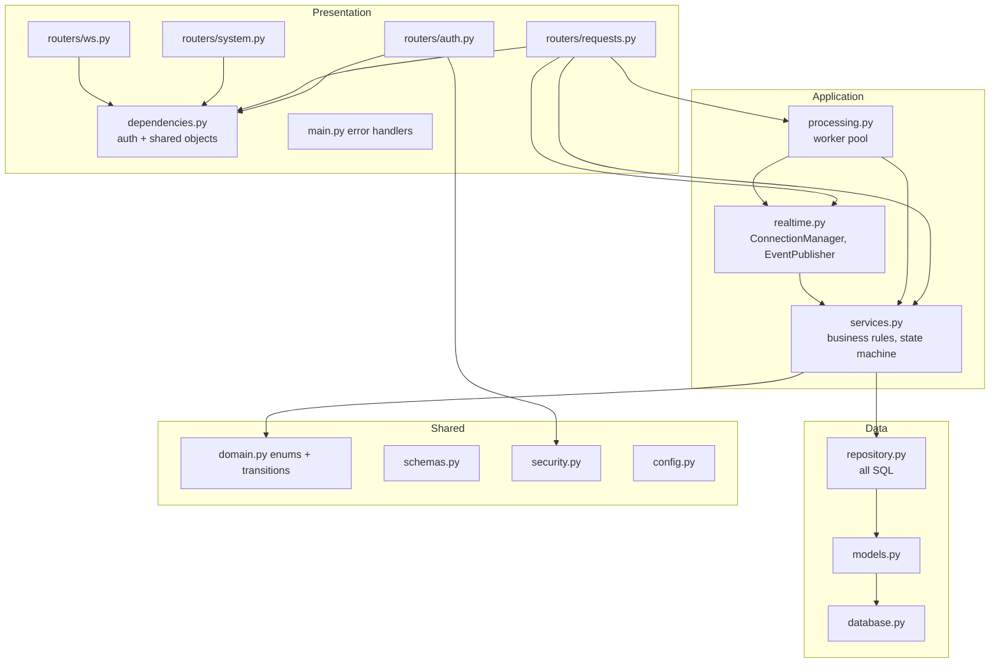
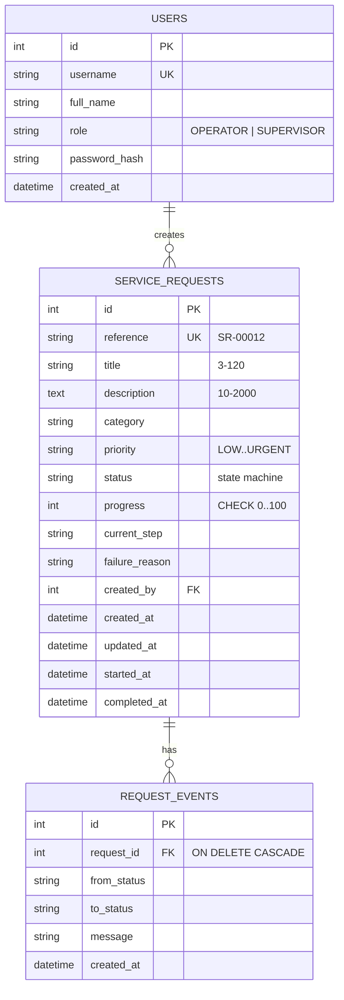
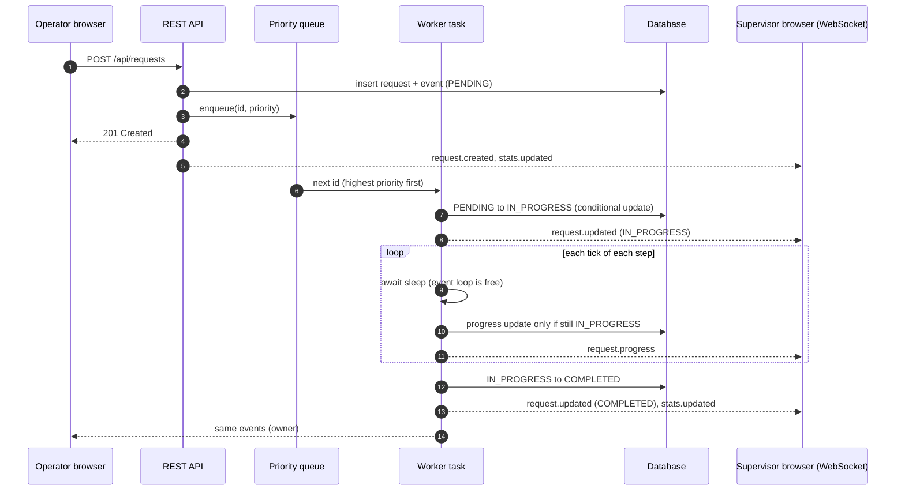
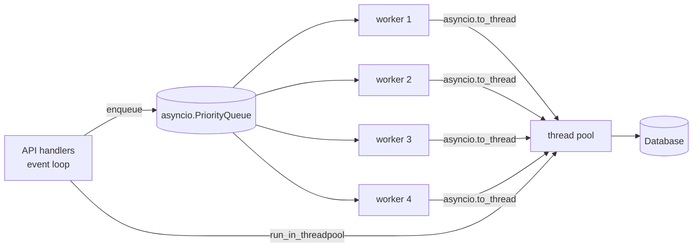

# 2. System design

## 2.1 High-level architecture

The browser talks to one server. It uses **REST for commands and queries** and a **WebSocket for server-to-client
push**. Everything the user does goes through REST. Everything the user *sees changing* arrives over the socket.

## 2.2 Component diagram

| Layer | Rule |
|-------|------|
| Routers | Parse input, call one service method, return the result. No business logic, no SQL |
| Service | All business rules and permission checks. Each public method is one transaction |
| Repository | The only place that builds queries |
| Realtime / processing | Know about events and workers, never about HTTP |

The frontend mirrors this on a smaller scale: `api.js` (REST), `socket.js` (live connection), `store.js`
(state), `components/*` (rendering), `main.js` (wiring).

## 2.3 Database design

Constraints worth noting:

- Enumerated columns are stored as strings with `CHECK` constraints, so bad data is rejected by the database too.
- `progress` has a `CHECK (progress BETWEEN 0 AND 100)`.
- `reference` and `username` are unique.
- Foreign keys are enforced (`PRAGMA foreign_keys=ON` for SQLite).
- Indexes: `status`, `(created_by, created_at)` for the operator list, `request_id` on events.
- `request_events` is append-only and is the audit trail shown in the UI.

## 2.4 REST API design

Base path `/api`. JSON in and out. Errors always look like
`{"error": {"code": "...", "message": "...", "details": [{"field", "message"}]}}`.

| Method | Path | Purpose | Success | Typical errors |
|--------|------|---------|---------|----------------|
| POST | `/auth/login` | Exchange credentials for a token | 200 | 401, 422 |
| GET | `/auth/me` | Who am I | 200 | 401 |
| GET | `/requests` | Search / filter / sort / paginate | 200 | 401, 422 |
| POST | `/requests` | Submit a request | 201 | 401, 422 |
| GET | `/requests/stats` | Counters for the dashboard | 200 | 401 |
| GET | `/requests/{id}` | Details + history | 200 | 401, 404 |
| PATCH | `/requests/{id}` | Edit while pending | 200 | 404, 409, 422 |
| POST | `/requests/{id}/cancel` | Cancel pending / running request | 200 | 404, 409 |
| POST | `/requests/{id}/retry` | Re-queue a failed request | 200 | 404, 409 |
| GET | `/health` | Liveness, queue depth, connections | 200 | |

Design choices: nouns for resources, verbs only for state transitions (`cancel`, `retry`); `409 Conflict` for
"not allowed in the current state"; `422` for validation; `404` for both missing and not-yours.
Interactive docs are generated at `/docs` (Swagger UI) and `/redoc`.

## 2.5 WebSocket communication flow

Endpoint: `GET /ws?token=<access token>`. Invalid token: the server accepts, then closes with code **4401**.

Every message uses one envelope: `{"type": "...", "data": {...}, "ts": "ISO-8601"}`.

| Direction | Event | When | `data` |
|-----------|-------|------|--------|
| server to client | `connection.ready` | right after connecting | user and role |
| server to client | `stats.updated` | on connect, and whenever counts change | dashboard counters |
| server to client | `request.created` | a request is submitted | full request |
| server to client | `request.updated` | status or details changed (started, completed, failed, cancelled, edited, retried) | full request |
| server to client | `request.progress` | progress or step ticked while running | full request |
| client to server | `ping` (text) | every 25 s | |
| server to client | `pong` | reply to ping | null |

**Who receives what:** supervisors receive every event; an operator only receives events for requests they own.
`stats.updated` is computed per audience, so an operator's counters only count their own requests.
`request.progress` does not trigger a stats recalculation because progress ticks do not change any count.

**Reconnect:** the client retries with exponential backoff (1 s up to 15 s). After a successful reconnect it
reloads the list and counters once, because events sent while disconnected are not replayed.

## 2.6 Concurrency model

- **Workers.** `WORKER_COUNT` asyncio tasks (default 4) pull from a priority queue. Waiting is `await asyncio.sleep`,
  so a worker costs almost nothing while it waits and hundreds of in-flight requests are possible.
- **Never block the loop.** The SQLAlchemy code is synchronous, so every database call is executed in a worker
  thread with `asyncio.to_thread` / `run_in_threadpool`. The event loop only ever awaits, which keeps REST and
  WebSocket traffic responsive while work is running (covered by `test_api_stays_responsive_and_requests_run_concurrently`).
- **Priority.** Queue items are `(priority_rank, sequence, id)`. Rank orders by urgency, the sequence number
  keeps first-come-first-served inside a priority level.
- **Thread safety without locks.** No mutable state is shared between workers. The database is the shared
  state, and every transition is a *compare-and-set*: `UPDATE ... SET status=:new WHERE id=:id AND status IN (:expected)`.
  If a user cancels while a worker finishes, exactly one of them wins and the other is told (`409` for the user,
  `None` for the worker, which then stops quietly).
- **Cancellation.** There is no cancel flag to keep in sync. The next progress update only matches rows that are still
  `IN_PROGRESS`; for a cancelled request it matches nothing and the worker leaves.
- **Duplicates are harmless.** Changing priority re-enqueues the id. The older queue entry is skipped later
  because the request is no longer `PENDING`.
- **Isolation of failures.** An exception inside one request is caught in the worker loop, marks that request
  `FAILED`, and the worker moves on to the next one.
- **Crash recovery.** At startup, `IN_PROGRESS` rows (their worker died with the process) are marked failed and
  automatically re-queued, together with everything still `PENDING`.
- **Broadcast safety.** Each socket has a send lock (two coroutines must not write to one socket at once), sends
  have a 5 s timeout, and a dead or slow socket is dropped instead of stalling everyone else. Stats recalculation
  is coalesced: a burst of changes triggers at most one extra pass.

## 2.7 Technology stack and justification

| Concern | Choice | Why |
|---------|--------|-----|
| Language / runtime | Python 3.11+ | Fast to write and read; first-class asyncio |
| Web framework | **FastAPI** + uvicorn | Native async, built-in WebSocket support, automatic request validation and OpenAPI docs |
| Validation | Pydantic v2 | Declarative rules shared by validation, serialisation and docs |
| ORM / DB access | SQLAlchemy 2.0 | Mature, typed models, database-agnostic |
| Database | SQLite (WAL), PostgreSQL-ready | Zero-setup for reviewers; one setting changes it for production |
| Real-time | Native WebSockets | Required by the brief; lower latency and overhead than polling or SSE for bi-directional keep-alive |
| Concurrency | asyncio tasks + thread offload | Right fit for I/O-bound, long-waiting work; avoids thread-per-request cost |
| Auth | PBKDF2 + HMAC-signed tokens (stdlib) | No extra dependencies; stateless so it scales across instances |
| Frontend | Vanilla JS (ES modules), CSS | No build tooling to install or break; the app is small enough that a framework would add more than it removes. State management is a ~20-line store |
| Tests | pytest + FastAPI TestClient | Exercise real HTTP, WebSocket and worker behaviour end to end |
| Packaging / CI / Deployment | Docker, docker-compose, GitHub Actions CI, Render (cloud container deployment) | Reproducible local and cloud deployment, automated CI test execution |

Alternatives considered: Celery/RQ for background jobs (needs a broker; overkill for one process, but the
service/engine boundary would make swapping it in straightforward); Server-Sent Events (simpler, but one-way);
React (better for a larger UI, unnecessary here).

## 2.8 Scaling beyond one instance

1. Move to PostgreSQL (`DATABASE_URL`).
2. Run several app instances behind a load balancer. Tokens are stateless, so no sticky sessions are needed for REST.
3. Fan events out across instances with Redis pub/sub: `EventPublisher` publishes to a channel and each
   instance's `ConnectionManager` delivers to its own sockets.
4. Make the queue shared (Redis list / a `SKIP LOCKED` query on `PENDING` rows) so any instance's workers can
   claim work. The compare-and-set transition already guarantees a request is claimed by exactly one worker.

## 2.9 Security notes

- Passwords: PBKDF2-HMAC-SHA256, per-user salt, constant-time comparison.
- Tokens: HMAC-SHA256 signed, expire after `TOKEN_TTL_MINUTES`. Change `SECRET_KEY` outside development.
- Login rate limiting: sliding-window counter per client IP (10 attempts / 60 s). Exceeding the limit returns HTTP 429 with a `Retry-After` header. The counter resets on a successful login.
- WebSocket authentication: the client calls `POST /api/auth/ws-ticket` (over an already-authenticated HTTPS session) to exchange its Bearer token for a 30-second single-use ticket. The WebSocket URL carries only the ticket (`?ticket=…`). Even if the ticket appears in an access log it cannot be replayed: the server deletes it on first use and rejects any duplicate. The long-lived Bearer token is never exposed in a URL.
- Authorisation lives in the service layer so it cannot be bypassed by a new router.
- No string-built SQL; user search text has `%` and `_` escaped.
- UI never inserts server text as HTML.
- Known remaining gaps (out of scope, noted honestly): no refresh tokens, token kept in `localStorage`.
